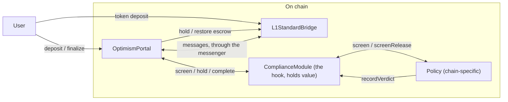
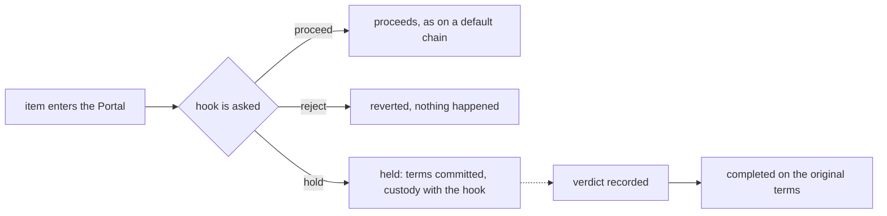

# Compliance Module

<!-- START doctoc generated TOC please keep comment here to allow auto update -->
<!-- DON'T EDIT THIS SECTION, INSTEAD RE-RUN doctoc TO UPDATE -->
**Table of Contents**

- [Overview](#overview)
- [Problem Statement](#problem-statement)
- [Goals](#goals)
- [Non-goals](#non-goals)
- [Architecture](#architecture)
- [Definitions](#definitions)
  - [Item](#item)
  - [Identifier](#identifier)
  - [Screening](#screening)
  - [Screening Outcome](#screening-outcome)
  - [Hook](#hook)
  - [Terms Commitment](#terms-commitment)
  - [Verdict](#verdict)
  - [Completion](#completion)
  - [Policy](#policy)
  - [Parties](#parties)
  - [Token Bridge Message](#token-bridge-message)
  - [Finalizable Time](#finalizable-time)
- [Item Lifecycle](#item-lifecycle)
- [Custody Model](#custody-model)
- [Trust Assumptions](#trust-assumptions)
- [Backward Compatibility](#backward-compatibility)
- [Impact on Developer Experience](#impact-on-developer-experience)

<!-- END doctoc generated TOC please keep comment here to allow auto update -->

This document is not finalized and should be considered experimental.

## Overview

An OP Stack chain must be able to condition every deposit and withdrawal that crosses its canonical bridge. The
`OptimismPortal` stores one **optional** hook address. While that address is `address(0)`, the chain behaves exactly
as any default OP Stack chain. When it is set, the Portal offers every item (see [Item](#item)) to the hook before any
value reaches its recipient.

For each of the items the hook can answer in one of three ways:

- **Proceed.** The item takes today's normal path, nothing changes.
- **Hold.** The Portal commits the item's terms and its value moves to the hook. The item executes later, on exactly those
  terms once the item has been cleared (see [Verdict](#verdict)).
- **Reject.** The call reverts and nothing is consumed. A deposit never happens, and a withdrawal stays finalizable.

The hook is an interface, so any contract can implement it. These pages specify the interface, one reference
implementation called the `ComplianceModule`, and the interface between that module and the policy owned by the chain, which
decides what is acceptable. What a policy decides is outside this specification.

The feature is specified across four further pages:

- [OptimismPortal](./optimism-portal.md). The hook address, the `IBridgeHook` interface, how the Portal names an item,
  commits to its terms, and runs a held item later.
- [L1StandardBridge](./l1-standard-bridge.md). How the escrow of a held token transfer moves to the hook and back.
- [Policy](./policy.md). The `IPolicy` interface, and what a hook requires of any policy behind it.
- [ComplianceModule](../contracts/L1/compliance-module.md). The reference hook implementation, which owns the verdict
  registry, custody of held value, and completion.

## Problem Statement

Some chains must condition value crossing their canonical bridge, and must enforce that condition where it cannot be
bypassed.

Screening at the sequencer only covers transactions submitted to it. It does not
cover deposits submitted to L1, which carry forced inclusion, so the sequencer has no say in whether they are included.
Withdrawals finalize on L1, outside the sequencer's reach. Since both deposits and withdrawals cross the
`OptimismPortal`, it is there where the chain can enforce a screening condition that cannot be bypassed.

Since the condition and the rules under what an item can pass through L1 and L2 boundaries belongs to the chain, the
protocol only supplies: a way to defer an item, take custody of its value, and resume it later on the terms it was
deferred with.

## Goals

- Every ETH and ERC-20 deposit and withdrawal is screened through the hook before any value reaches its recipient.
- Items that carry no value are offered too. A zero-value deposit still executes an arbitrary L2 call chosen by an L1
  sender, such as a transfer between L2 accounts.
- An item can be deferred and resumed later on **identical terms**, with no user action in between.
- Deferred value leaves the protocol contracts.
- An item is identified unambiguously.
- The condition can be switched off for new items without releasing items already held.
- No policy may redirect value or alter an item's terms.

## Non-goals

- Support for the `L1ERC721Bridge` or third-party bridge contracts.
- Transactions users submit to the sequencer.
- What a policy decides, the lists it reads, and the offchain service behind it.

## Architecture

- The **`OptimismPortal`** stores the hook address and calls the hook from `depositTransaction` and
  `finalizeWithdrawalTransaction` when one is set. It recognizes the messages the two canonical bridges exchange, and
  it commits the terms of every item it defers.
- The **`L1StandardBridge`** gains two entry points, callable only by the Portal, that move the escrow of a token
  transfer to the hook and back. It keeps its own accounting and reads its own messages.
- The **`ComplianceModule`** implements the hook. It owns the verdict registry, custody of any held value, and completion.
  It also decodes canonical messages to name the real parties for the policy. **It is the only new contract that holds
  value.**
- The **policy** decides what items go through based on its own set of rules.

The portal gains the
ability to defer an item and resume it later, which a rate limiter, a per-token pause or a circuit breaker would use
the same way.

Each contract moves only the value it holds. A hold is the Portal's own record, and the bridge keeps none. The Portal
recognizes the messenger envelope and hands the bridge the message inside it. The bridge decodes that inner call
itself, moves the escrow it names, and updates its own accounting.

The Portal builds every item and records its terms, and the hook only picks which item moves. No policy, however it is
written, can redirect value or change what an item does. It can delay an item or refuse it, and nothing else.

The Portal is the only place the hook is asked. Letting the `L1StandardBridge` screen its own token transfers looks
simpler, because the parties arrive there as typed arguments. It does not work for withdrawals. A token withdrawal
reaches the bridge inside the messenger's relay, after the Portal has already consumed the withdrawal. A revert there
becomes a failed message rather than a rejection, so the bridge could hold an item but never refuse one.

## Definitions

### Item

An **Item** is one deposit or one withdrawal, as the `OptimismPortal` sees it. It can carry ETH, tokens, or no value
at all. The Portal builds an item from the sender, target, value and call it sees. Each item is unique in its
direction.

### Identifier

An **Identifier** is an item's name, a hash of all of the item's fields. The `OptimismPortal` and the hook compute it
the same way, so both agree on which item a [Verdict](#verdict) names, and the verdict covers every term.

Each direction takes its unique field from a different source. A withdrawal has its withdrawal hash, so its identifier
is known before finalization. A deposit has no unique field, because identical deposits in the same block are
otherwise indistinguishable, so the Portal assigns it a counter when it screens it.

Take two deposits from the same address for the same amount, to the same L2 address in the same L1 block. Every field
the Portal sees is identical, so without the counter both would share one identifier, and a clearance for one would
release the other.

### Screening

**Screening** is offering an item to the hook, which answers with a [Screening Outcome](#screening-outcome). A deposit
is screened when it is submitted. A withdrawal is screened when it is finalized.

### Screening Outcome

A **Screening Outcome** is the hook's answer for one item. There are three possible outcomes:

- **Proceed.** The item takes the normal path, unchanged.
- **Hold.** The item is deferred. The Portal commits its terms and its value moves to the hook.
- **Reject.** The call reverts and nothing is consumed. A rejected deposit never happens, and a rejected withdrawal
  remains finalizable and can be attempted again.

A hook need not use all three. An asynchronous policy proceeds or holds and never rejects. A synchronous policy
proceeds or rejects and never holds.

### Hook

The **Hook** is the contract at the `OptimismPortal`'s hook address. The Portal asks it about every item and the hook
takes custody of held value. Any contract that implements `IBridgeHook` can be a hook.

### Terms Commitment

A **Terms Commitment** is the `OptimismPortal`'s record of a held item. It is keyed by the item's
[Identifier](#identifier) for a deposit, and by the withdrawal hash for a withdrawal, so it binds every term. Only an
item that matches a commitment can [complete](#completion), and only once.

### Verdict

A **Verdict** is a decision about one item, recorded through the [Policy](#policy) against the item's
[Identifier](#identifier). A verdict can be recorded before the item exists. The policy can revoke it.

A clear verdict is what lets value move. With one, a withdrawal pays out at finalization and a held item can complete,
as long as the policy still allows it when the value moves. An item without one is uncleared.

### Completion

**Completion** is moving a held item to its original destination, on the committed terms. Anyone can start it at the
hook once the item has been cleared. A held item cannot be partially completed, and it is never returned to its sender.

### Policy

A **Policy** is a contract **the chain operator owns** that decides the [Screening Outcome](#screening-outcome) for
an item. The hook asks it when an item is screened and again when value moves, and takes verdicts only from it.

### Parties

The **Parties** of an item are the addresses the policy screens for it. For a message sent through the messengers, the
hook decodes the real sender and recipient from the envelope, and falls back to the outer addresses if it cannot.

### Token Bridge Message

A **Token Bridge Message** is a token transfer between the `L1StandardBridge` and the `L2StandardBridge`, sent through
the messengers. The `OptimismPortal` recognizes it in two steps. The item's outer sender and target must be the
messengers, and the envelope must decode to a `finalizeBridgeERC20` call from the standard bridge. Since nobody can choose
those fields, a message that matches came from the bridge. The Portal fills the item's token fields from that inner
call, and moves escrow only for such a message.

### Finalizable Time

The **Finalizable Time** of a withdrawal is when it became finalizable. The `OptimismPortal` passes it to the hook at
screening, so a policy can decide how long to wait before it holds an uncleared withdrawal.

## Item Lifecycle

An item is offered to the hook once when it enters. If it is held, it is checked again when its value moves, so the
policy is consulted twice on a held item.

A verdict lives against an [Identifier](#identifier), not against the item itself. The identifier must name exactly one
item, otherwise one clearance could release another.

## Custody Model

The contract holding the value is the one that hands it to the hook. The `OptimismPortal` decides when.

**ETH moves through the Portal.** Every ETH route, through the bridge or through the messenger, ends at the Portal. On
a hold, the Portal sends the ETH to the hook. On completion it comes back as the value of the completion call, and the
Portal checks it against the committed terms.

**Tokens move through the bridge.** The `L1StandardBridge` escrows them, and it is the only contract that moves them
to the hook and back. Tokens native to L2 are burned and minted rather than escrowed, so only their message is held,
and the value behind such an item stays in the `L2StandardBridge`'s escrow until it completes.

For a [Token Bridge Message](#token-bridge-message), the Portal hands the bridge the inner message and asks it to move
escrow. The bridge decodes that inner call itself, runs its own checks, and records the balance change in its own
accounting. It records nothing about the hold:

- **Hold.** The Portal calls the bridge with the inner `finalizeBridgeERC20` message it is holding. The bridge checks
  the selector, reads the tokens and the amount from it, and debits its escrow for that token pair, which reverts if
  the escrow is short. It then sends the tokens to the hook.
- **Completion.** The hook approves the bridge for the item's amount and calls the Portal, which asks the bridge to
  take the tokens back and credit its escrow. The normal path then runs, so a deposit is emitted to L2 and a withdrawal
  is relayed.

The bridge does not depend on the hook, because only the Portal can send its escrow to the hook or take it back.

## Trust Assumptions

A chain that sets a hook address accepts the following, on top of the trust model of a default OP Stack chain.

**The chain is not a Stage 1 Rollup.** A hook that holds indefinitely is a permanent
[Withdrawal Liveness](../../protocol/stage-1.md#withdrawal-liveness) failure caused by an actor that is neither the
Security Council nor the Proxy Admin Owner. Users have to trust the chain operator not to censor them.

**Whoever can upgrade the hook is the custodian of all deferred value.** That authority is not constrained to be the
chain's `ProxyAdmin` owner. What an upgraded hook does with value already in its custody is outside the protocol's
guarantees.

**The policy decides who can clear an item.** A compromised policy can complete held items early, and so can any role
it trusts. The value still only reaches the item's original destination. A compromised policy can also hold or refuse
any new item.

**A failing policy can halt bridging.** The `ComplianceModule`'s
[disable switch](../contracts/L1/compliance-module.md#disable) exists so that a problem in the policy, or a long
outage of the screening service, cannot block bridging indefinitely. It is not a release. While it is on, every
deposit proceeds without the policy being asked, and so does every withdrawal initiated after the cutoff. Items
already held, and withdrawals initiated before the cutoff, are still screened. A problem in the hook itself is fixed
by upgrading it.

## Backward Compatibility

The change is limited to L1 contracts, with no multi-client or consensus impact. A held deposit emits no
`TransactionDeposited` event, so the derivation pipeline sees nothing until the deposit completes, and then sees an
ordinary deposit.

For a chain that does not set a hook, behavior does not change, but two things change either way:

- The `L1StandardBridge` gains two entry points that only the `OptimismPortal` can call.
- The `OptimismPortal` gains completion functions, while existing user entry points are unchanged.

For a chain that enables it, these assumptions break:

- A successful `depositTransaction` no longer implies that the deposit reaches L2.
- A successful ERC-20 deposit, and the `ERC20DepositInitiated` and `SentMessage` events it emits, no longer imply that
  the deposit reaches L2.
- `finalizeWithdrawalTransaction` can revert for a withdrawal that is not cleared, and once the hook holds it, it can
  succeed without paying the recipient.
- Held deposits complete out of submission order, because a verdict for a later item can land first.

A `RelayedMessage` event still implies the recipient was paid, because a withdrawal is held before the messenger
relays it.

## Impact on Developer Experience

No hook is set by default, so developers on chains that do not enable it see no difference.

For a chain that enables it:

- A deposit may be held. The bridge call succeeds, no `TransactionDeposited` event is emitted, and the value sits with
  the hook. The item completes later with no further action from the user. SDKs and bridge interfaces should watch the
  hook's events and show a pending state rather than success.
- A withdrawal that is not cleared cannot be finalized until it is, and the revert lets a bridge interface show it as
  pending. Once the policy stops waiting, finalizing it holds it, so the recipient is not paid until completion.

Integrators that bridge programmatically, including contracts that call `depositTransaction` directly, have to handle
the held case rather than assuming the deposit succeeds atomically. Bridges and escrows outside the core contracts
should treat a deposit as pending until it completes.

Tooling is able to find the hook through the `OptimismPortal`'s hook address.
