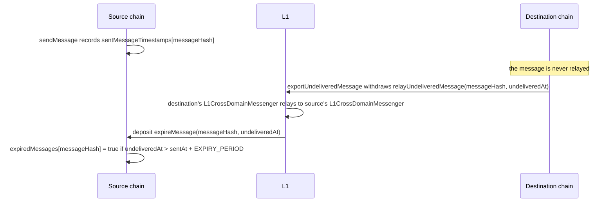

# Message Expiry

<!-- START doctoc generated TOC please keep comment here to allow auto update -->
<!-- DON'T EDIT THIS SECTION, INSTEAD RE-RUN doctoc TO UPDATE -->
**Table of Contents**

- [Overview](#overview)
- [Flow](#flow)
- [Safety](#safety)
- [Assumptions](#assumptions)
  - [aME-001: Authorized chains run standard contracts](#ame-001-authorized-chains-run-standard-contracts)
    - [Mitigations](#mitigations)
  - [aME-002: The expiry period is at least the expiry window](#ame-002-the-expiry-period-is-at-least-the-expiry-window)
    - [Mitigations](#mitigations-1)
  - [aME-003: Applications bind expiry to their own sends](#ame-003-applications-bind-expiry-to-their-own-sends)
    - [Mitigations](#mitigations-2)
- [Invariants](#invariants)
  - [iME-001: A message is never both relayed and expired](#ime-001-a-message-is-never-both-relayed-and-expired)
    - [Impact](#impact)
    - [Dependencies](#dependencies)
  - [iME-002: Only the destination chain can attest](#ime-002-only-the-destination-chain-can-attest)
    - [Impact](#impact-1)
    - [Dependencies](#dependencies-1)
  - [iME-003: Only two functions send as the L1CrossDomainMessenger](#ime-003-only-two-functions-send-as-the-l1crossdomainmessenger)
    - [Impact](#impact-2)
    - [Dependencies](#dependencies-2)
  - [iME-004: Expiry is final](#ime-004-expiry-is-final)
    - [Impact](#impact-3)
    - [Dependencies](#dependencies-3)
  - [iME-005: A message that is never relayed can always expire](#ime-005-a-message-that-is-never-relayed-can-always-expire)
    - [Impact](#impact-4)
    - [Dependencies](#dependencies-4)
- [Activation](#activation)

<!-- END doctoc generated TOC please keep comment here to allow auto update -->

## Overview

Executing messages cannot be included through deposit transactions (see
[Depositing an Executing Message](./derivation.md#depositing-an-executing-message)). A destination chain's sequencer
that refuses to relay a message can therefore keep it from ever being delivered. Once the
[expiry window](./derivation.md#expiry-window) has passed, no valid block can relay the message at all.

Message expiry lets the source chain learn that a message can never be delivered, using only withdrawals and
deposits, which a sequencer cannot censor. The source chain's `L2ToL2CrossDomainMessenger` records this per message
in `expiredMessages`, and applications can undo the send, as
[`SuperchainETHBridge.refundETH`](./superchain-eth-bridge.md#refundeth) does.

This page describes the design and why it is safe. The contract functions are specified with their contracts:

- [`L2ToL2CrossDomainMessenger`](./predeploys.md#expiring-messages): `sentMessageTimestamps`, `expiredMessages`,
  `expireMessage` and `EXPIRY_PERIOD`;
- [`UndeliveredMessageExporter`](./predeploys.md#undeliveredmessageexporter): `exportUndeliveredMessage`;
- [`L1CrossDomainMessenger`](./l1-cross-domain-messenger.md#relayundeliveredmessage): `relayUndeliveredMessage`.

## Flow

For a message sent from a source chain to a destination chain and never relayed there:

1. On the source chain, `L2ToL2CrossDomainMessenger.sendMessage` records `sentMessageTimestamps[messageHash]`.
2. On the destination chain, anyone calls `UndeliveredMessageExporter.exportUndeliveredMessage` with the message's
   preimage and the source chain's `L1CrossDomainMessenger`. The exporter computes `messageHash` with the destination
   chain as the destination, checks that the destination chain has not relayed it, and sends
   `relayUndeliveredMessage(messageHash, undeliveredAt)` through the destination chain's `L2CrossDomainMessenger`,
   where `undeliveredAt` is the destination chain's block timestamp. This is not an executing message, so it can be
   included through a deposit if the destination chain's sequencer censors it.
3. On L1, once the withdrawal is proven and finalized, the destination chain's `L1CrossDomainMessenger` relays it to
   the source chain's `L1CrossDomainMessenger.relayUndeliveredMessage`, which sends
   `expireMessage(messageHash, undeliveredAt)` to the source chain as a deposit.
4. On the source chain, `expireMessage` marks the message expired if
   `undeliveredAt > sentMessageTimestamps[messageHash] + EXPIRY_PERIOD`.
5. On the source chain, applications read `expiredMessages(messageHash)` to undo the send.

## Safety

A message is never both relayed and expired
([iME-001](#ime-001-a-message-is-never-both-relayed-and-expired)). This holds because:

- An executing message is invalid if its block timestamp is more than `EXPIRY_WINDOW` after the timestamp of its
  initiating message (see [Message Expiry Invariant](./messaging.md#message-expiry-invariant)).
  `sentMessageTimestamps[messageHash]` is that initiating timestamp, and it is written once.
- The exporter on the destination chain attests that the message was not relayed by its block timestamp
  `undeliveredAt`. Any later transaction on the destination chain, including one later in the same block, has a
  timestamp of at least `undeliveredAt`. If `undeliveredAt > sentMessageTimestamps[messageHash] + EXPIRY_PERIOD` and
  `EXPIRY_PERIOD` is at least `EXPIRY_WINDOW`, no later transaction can relay the message.
- Only the destination chain can attest for the message, because the exporter hashes it with its own chain ID as the
  destination ([iME-002](#ime-002-only-the-destination-chain-can-attest)).
- Only chains whose portals the source chain's `ETHLockbox` authorizes can attest
  ([aME-001](#ame-001-authorized-chains-run-standard-contracts)).
- Only `relayUndeliveredMessage` can make the source chain's `L1CrossDomainMessenger` the sender of `expireMessage`
  ([iME-003](#ime-003-only-two-functions-send-as-the-l1crossdomainmessenger)).
- The trusted L2 sender is the `UndeliveredMessageExporter`, whose proxy had no implementation before the upgrade
  that introduced it, so no withdrawal from it can predate that upgrade.

The `L2ToL2CrossDomainMessenger` MUST NOT re-emit a `SentMessage` event for a message, and every way of relaying a
message MUST set `successfulMessages`. An upgrade that breaks either rule breaks this argument.

## Assumptions

### aME-001: Authorized chains run standard contracts

We assume that every chain whose portal the source chain's `ETHLockbox` authorizes runs the standard
`UndeliveredMessageExporter` and `L2ToL2CrossDomainMessenger` at their predeploy addresses. We assume that L1
finalizes withdrawals only from blocks that are valid under the interop [derivation rules](./derivation.md).

`relayUndeliveredMessage` does not compare the calling chain with the message's destination. The binding comes only
from the exporter, which hashes the message with its own chain ID as the destination, so this assumption is
load-bearing.

#### Mitigations

- Each such chain can already withdraw the source chain's ETH from the shared `ETHLockbox`, so trusting its
  withdrawals for expiry adds no new trusted party.

### aME-002: The expiry period is at least the expiry window

We assume that every node and proof program of each destination chain enforces the
[expiry window](./derivation.md#expiry-window) of `EXPIRY_WINDOW`. We assume that each chain's `EXPIRY_PERIOD` is
at least `EXPIRY_WINDOW` and stays so across upgrades. The messenger cannot check this: `initialize` checks only
`0 < EXPIRY_PERIOD <= 365 days`.

#### Mitigations

- `EXPIRY_WINDOW` is a protocol constant, not a configuration value.
- On production networks `EXPIRY_PERIOD` is 8 days, one day more than `EXPIRY_WINDOW`, and later upgrades keep the
  configured period.

### aME-003: Applications bind expiry to their own sends

We assume that an application that undoes a send on expiry computes the message hash with itself as the sender. We
assume that it undoes each send at most once and treats an expired message as never delivered. `expiredMessages` is
public, so an application that trusts a message hash from its caller can be fooled.

#### Mitigations

- [`SuperchainETHBridge.refundETH`](./superchain-eth-bridge.md#refundeth) is the reference pattern: it computes the
  hash from its own arguments, with itself as the sender, and records each refund.

## Invariants

### iME-001: A message is never both relayed and expired

A message MUST NOT be both relayed on its destination chain and marked expired in `expiredMessages` on its source
chain.

#### Impact

**Severity: Critical**

If this invariant is broken, every application that undoes a send on expiry pays out twice. The
`SuperchainETHBridge` would both relay and refund the same ETH.

#### Dependencies

- [aME-001](#ame-001-authorized-chains-run-standard-contracts)
- [aME-002](#ame-002-the-expiry-period-is-at-least-the-expiry-window)
- [iME-002](#ime-002-only-the-destination-chain-can-attest)
- [iME-003](#ime-003-only-two-functions-send-as-the-l1crossdomainmessenger)

### iME-002: Only the destination chain can attest

`expireMessage` MUST mark a message expired only on an attestation from the `UndeliveredMessageExporter` of the chain
that the message hash names as its destination.

#### Impact

**Severity: Critical**

If this invariant is broken, another chain could attest that a message was not relayed after its destination
relayed it, breaking [iME-001](#ime-001-a-message-is-never-both-relayed-and-expired).

#### Dependencies

- [aME-001](#ame-001-authorized-chains-run-standard-contracts)

### iME-003: Only two functions send as the L1CrossDomainMessenger

This chain's `L1CrossDomainMessenger` MUST be the L1 sender of a message on L2 only through
[`relayUndeliveredMessage`](./l1-cross-domain-messenger.md#relayundeliveredmessage) and
[`syncETHLiquidityPause`](./l1-cross-domain-messenger.md#syncethliquiditypause). Its `relayMessage` refuses messages
that target itself (see [Unsafe Targets](./l1-cross-domain-messenger.md#unsafe-targets)).

#### Impact

**Severity: Critical**

`expireMessage` and `ETHLiquidity.setPaused` both trust this sender. If this invariant is broken, anyone could
expire a message that can still be relayed, or pause and unpause `ETHLiquidity`.

#### Dependencies

None

### iME-004: Expiry is final

`expiredMessages[messageHash]` MUST change only from `false` to `true`, and only for a message with a recorded send
timestamp.

#### Impact

**Severity: High**

If this invariant is broken, an application could see a send that it already undid become deliverable again, or a
message that was never sent from this chain marked expired.

#### Dependencies

None

### iME-005: A message that is never relayed can always expire

Anyone MUST be able to make a message expire once its destination chain has not relayed it by the end of
`EXPIRY_PERIOD`. This requires a destination chain whose portal the source chain's `ETHLockbox` authorizes,
withdrawals that finalize on L1, and deposits that are included on the source chain. Each step that fails, such as
for gas or while a chain is paused, MUST be replayable.

This does not cover a message with no recorded send timestamp, such as one sent before the messenger recorded
timestamps, or a message sent to a chain outside the source chain's cluster. Neither can ever expire.

#### Impact

**Severity: High**

If this invariant is broken, value sent in a message that is never relayed, such as ETH sent through the
`SuperchainETHBridge`, can never be recovered.

#### Dependencies

- [aME-001](#ame-001-authorized-chains-run-standard-contracts)

## Activation

- Every node and the proof program MUST enforce the [expiry window](./derivation.md#expiry-window) before expiry is
  relied on, and the messenger's [`EXPIRY_PERIOD`](./predeploys.md#expiring-messages) MUST be at least
  `EXPIRY_WINDOW`.
- The network upgrade that activates interop MUST install an `L2ToL2CrossDomainMessenger` with expiry and the
  `UndeliveredMessageExporter`. A frozen upgrade bundle for that fork that was snapshotted before these contracts
  existed MUST be snapshotted again first, so that no `L2ToL2CrossDomainMessenger` without expiry, which could
  resend a message after it expired, is ever live on a chain with expiry.
- Every chain in a cluster's dependency set MUST be authorized by the cluster's `ETHLockbox` and run the
  `UndeliveredMessageExporter`. Otherwise messages sent to it cannot expire.
